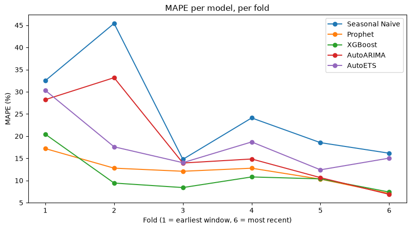

# Retail Sales Forecasting: Model Comparison and Backtest

Picks the most accurate, cost-effective method for forecasting daily store sales six weeks ahead, backed by a 6-window rolling backtest rather than a single, possibly-lucky train/test split.



**Problem.** Retailers plan staffing and stock roughly six weeks ahead. Picking the wrong forecasting method means overstaffing or understocking, and it isn't obvious upfront which common approach — classical statistics, Prophet, gradient-boosted trees — actually holds up over time rather than just looking good once.

**Approach.** Backtested five methods (Seasonal Naive, Prophet, XGBoost, AutoARIMA, AutoETS) across six rolling 42-day windows, each retrained on all prior data — not one split. Fed every model the **full calendar, including closed days**, plus known-in-advance `Promo`/`SchoolHoliday`/`StateHoliday` regressors — this alone flipped AutoETS from losing to the baseline every window to beating it every window. Forecast XGBoost **recursively**: lag features come only from its own prior predictions, never a fold's real future sales.

**Result.**

| Model | Mean MAPE | Beats baseline | Mean fit time/store |
|---|---|---|---|
| XGBoost | 11.14% | 6 of 6 windows | 3.2s |
| Prophet | 12.04% | 6 of 6 windows | 0.6s |
| AutoARIMA | 17.96% | 6 of 6 windows | 65.2s |
| Seasonal Naive (baseline) | 25.25% | — | ~0s |

XGBoost wins on accuracy; Prophet is the cost-conscious alternative, ~5x cheaper to retrain. Full result, WAPE check and recommendation: [Findings](#findings).

## Findings

- **Every model now beats the seasonal-naive baseline in all 6 of 6 windows**, including AutoETS — which lost to the baseline in every window before the full-calendar + exogenous-feature fix above.
- **WAPE (total error ÷ total actual sales) mostly confirms MAPE**, with one exception: the hardest window (Christmas/New Year) scores *worse* under WAPE for most models, because it weights errors by sales value — that window's problem is under/over-shooting the size of the December peak, not noisy low-value days.
- **AutoARIMA isn't worth its cost.** Its accuracy (17.96 MAPE) barely beats AutoETS's (18.02), for roughly two orders of magnitude more fit time.
- **Recommendation:** use **XGBoost** as the default — it wins on both accuracy and full-window consistency. Treat **Prophet** as the cost-conscious alternative, worth it once nightly compute cost across many stores becomes a constraint (see Scaling below). Skip AutoARIMA; AutoETS is the better `statsforecast` option if a fast, low-dependency model is ever needed.

Full per-fold breakdown and the fair-testing protocol (no leakage, fixed seeds, matched train/test windows across all five models): see [`single_store_forecast.ipynb`](single_store_forecast.ipynb).

## Scaling to all 1,115 stores (in progress)

The single-store result above raises a real multi-store question: compute cost
(AutoARIMA's ~65s/store fit, XGBoost's ~3.2s/store retrain) stops being a
rounding error once it's multiplied by 1,115 stores, nightly. `multi_store_forecast.ipynb`
works through that, tracked step by step in `MULTISTORE_PLAN.md`:

- Reuses the same full-calendar + exogenous-feature approach, validated against
  real data-quality issues found along the way (a genuine 184-day gap shared by
  181 stores, not just routine closed-day handling).
- Three-level EDA (group aggregate, per-store distributions, representative
  spot-checks) to check whether grouping stores by `StoreType`/`Assortment` is
  actually justified by the data, rather than assumed.
- Extends the single-store comparison to seven candidates: the four classical
  models above, Prophet (per-store), and XGBoost in three pooling strategies —
  global (one model, all stores, store ID as a feature), per-group, and
  per-store — backtested with the same rolling-origin CV protocol and ranked by
  RMSPE, Rossmann's own competition metric, with relative compute cost reported
  alongside accuracy rather than as an afterthought.
- Deliberately scoped to the model-selection decision, not a full production
  deployment (see `MULTISTORE_PLAN.md`'s decision log for the reasoning) — a
  separate project already demonstrates end-to-end deployment.

See `MULTISTORE_PLAN.md` for the current step and the reasoning behind each
decision along the way.

## Limitations & next steps

- **One store.** This backtest alone may not generalise across store types and locations — that's exactly what the multi-store work above tests.
- **Six test windows** is enough to show every model now beats the baseline consistently, not from one lucky window — but still too few folds for a rigorous confidence interval.
- **Promo/holiday schedules are assumed fully known at forecast time.** True in this backtest (Rossmann's historical flags); in a real deployment, promotions scheduled weeks ahead can still change.
- **Prophet can predict slightly negative sales on closed days** (additive regression, no floor at 0) — harmless here since closed days are excluded from scoring, but would need clamping to 0 if used directly.
- **Training-time figures are single-machine, single-run wall-clock measurements**, a directional signal rather than a precise benchmark.
- With another week, I'd finish the multi-store CV comparison above, add a couple of regression tests (e.g. the rolling backtest windows never overlap, RMSPE excludes zero-sales days), and curate `requirements.txt` down from a full `pip freeze` to just the libraries this project actually imports.

## Run it

```bash
git clone https://github.com/Ampofowaa/rossmann-sales-forecasting.git
cd rossmann-sales-forecasting
pip install -r requirements.txt
# Download train.csv, test.csv, store.csv from Kaggle into data/rossmann/ (not redistributed here)
jupyter nbconvert --to notebook --execute single_store_forecast.ipynb --output single_store_forecast.ipynb
```

Prophet's `cmdstanpy` backend needs a one-time compiled-model build on first install, which `pip install` alone doesn't trigger — see [cmdstanpy's install docs](https://mc-stan.org/cmdstanpy/installation.html) if `import prophet` fails. Takes roughly 6–8 minutes end to end, dominated by AutoARIMA's order search across 6 folds. Saved model files (`.pkl`) are excluded from version control; rerun the notebook to regenerate them.

## Project structure

```
.
├── single_store_forecast.ipynb   # main analysis: model comparison & backtest
├── multi_store_forecast.ipynb    # scaling to all 1,115 stores (in progress)
├── MULTISTORE_PLAN.md            # decision log for the multi-store work
├── docs/images/                  # chart exported from the notebook, used above
├── requirements.txt
├── LICENSE
└── data/rossmann/                # Kaggle data, not included — see Run it
```

## Tech stack

Python · pandas · `statsforecast` (AutoARIMA, AutoETS) · Prophet · XGBoost · `utilsforecast` · matplotlib · Jupyter

## Data

[Rossmann Store Sales](https://www.kaggle.com/c/rossmann-store-sales) (Kaggle): daily sales for 1,115 German drugstores. This comparison uses Store 1's full calendar — 942 days (1 Jan 2013 – 31 Jul 2015), including the 161 closed days — scored on the 781 open days per window, since MAPE is undefined at zero sales (the same convention as Rossmann's own RMSPE metric). Raw data files aren't redistributed here per Kaggle's terms — see Run it. Code in this repo is MIT-licensed (`LICENSE`); the dataset itself is third-party and not covered by it.

[GitHub](https://github.com/Ampofowaa) · [LinkedIn](https://www.linkedin.com/in/richlove-frimpong)
